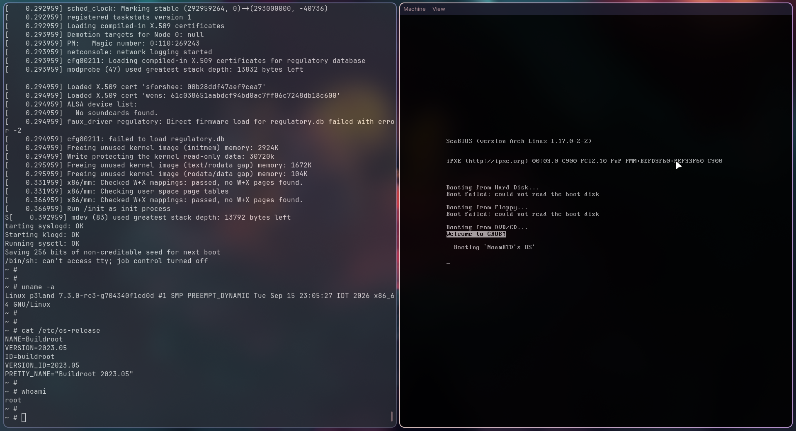
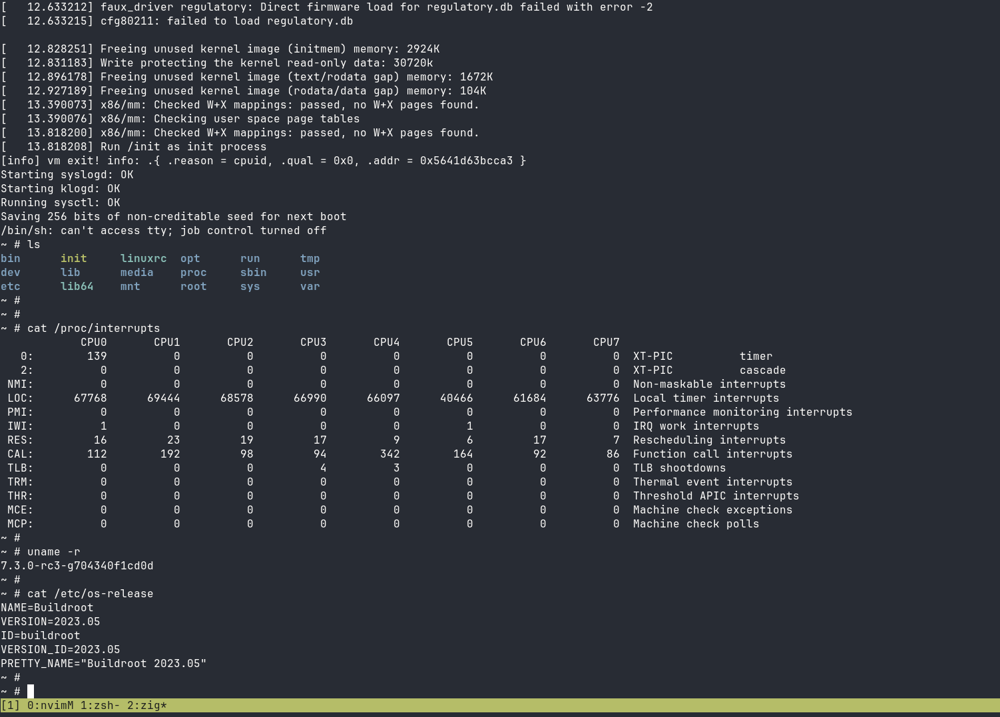
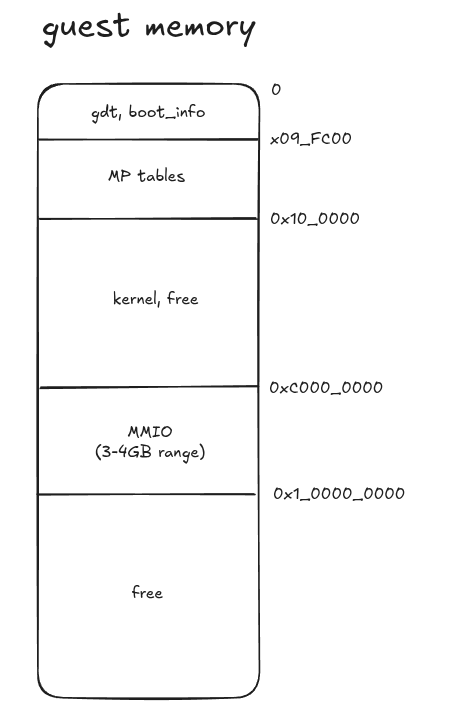

# AWS's EC2 (WIP)

Where I got up until now: A type 1 hypervisor for Intel VT-x, written from scratch in Zig, that boots Linux with multiple virtual CPUs!

Features implemented as of 2026-10-17:
- Bare-metal x86-64 kernel:
    - GRUB as bootloader
    - [Higher-half kernel](https://wiki.osdev.org/Higher_Half_Kernel) with 4-level paging
    - HHDM (direct mapping of all physical memory)
    - GDT, TSS, IDT, interrupts + IRQ handling ([8259 PIC](https://wiki.osdev.org/8259_PIC), [PIT](https://wiki.osdev.org/Programmable_Interval_Timer))
    - Memory allocators: free-list heap, bitmap page allocator, 1GB guest-RAM allocator
    - TSC frequency calibration against the PIT
- Intel VT-x virtualization:
    - [VMXON / VMCS](https://wiki.osdev.org/VMX) setup, and a run loop
    - [EPT](https://en.wikipedia.org/wiki/Second_Level_Address_Translation#Extended_Page_Tables) (Extended Page Tables), with a MMIO hole
    - Reading and writing guest memory, including walking the guest's page tables
    - CPUID virtualization
    - MSR virtualization
    - Control register emulation (CR0, CR3, CR4)
    - I/O port virtualization:
        - Virtual 8259 PIC
        - Virtual serial port (COM1)
    - MMIO emulation: EPT violations decoded with a small x86 `mov` instruction decoder
    - Interrupt delivery:
        - Hardware IRQ injection into guest
        - Interrupt-window exiting: a pending interrupt goes in as soon as guest can take it
    - `hlt` emulation (the guest core sleeps until an interrupt arrives)
- [Local APIC](https://wiki.osdev.org/APIC) virtualization:
    - LAPIC registers, IRR/ISR, EOI
    - The 8259 PIC routed through LINT0
    - LAPIC timer, delivered with the VMX-preemption timer
    - The TSC as the guest's clocksource
- **SMP:** Multiple CPUs in the guest
    - Several vCPUs time-share one physical core: a round-robin scheduler with 1ms slices, ended by the VMX-preemption timer
    - Each vCPU has its own VMCS, LAPIC, registers, and more!
    - IPIs: INIT and SIPI
    - full emulation of [INIT-SIPI-SIPI](https://wiki.osdev.org/Symmetric_Multiprocessing#BSP_Initialization_Code) from hardware side, for AP core bring up
- Linux guest:
    - [Linux x86 boot protocol](https://docs.kernel.org/arch/x86/boot.html) (32-bit entry)
    - [initramfs](https://docs.kernel.org/filesystems/ramfs-rootfs-initramfs.html) loading
    - An [MP table](https://wiki.osdev.org/MP_Specification) describing the guest's CPUs (no ACPI)
    - Boots an unmodified Linux kernel all the way to a userspace shell, tested with 1 to 8 CPUs

## Demo
#### Linux booting inside the hypervisor, running under QEMU:


#### Linux showing 8 cores inside the hypervisor (LAPIC && SMP virtualization working):


On the left is the guest's serial console: the Linux kernel boots and drops into a root shell on a Buildroot initramfs.

## Memory Managment

### Host Allocations

<details>
  <summary>[Click to show]</summary>

There are three distinct allocators, stacked on top of each other:

| Allocator | Manages | Granularity | Used for |
|---|---|---|---|
| `fla` (free list allocator, first-fit) | the first 1GB of physical RAM | bytes | Anything variable sized |
| page pool (bitmap allocator) | many pages carved out of `fla` at init | 4KB | VMXON region, VMCS, MSR bitmaps, EPT PML4/PDPTs, etc (4kb aligned blocks) |
| `GuestAllocator` (bitmap) | all of physical RAM | 1GB | Guest RAM |

A few decisions worth knowing:
- **The page pool is separate from `fla` on purpose.** `fla` puts a header before every allocation, and a 4KB-aligned request out of it would fragment the heap.
- **Guest RAM is not zeroed on allocation.** Zeroing 1GB blocks is expensive; this would

</details>

### Guest Memory Layout

<details>
  <summary>[Click to show]</summary>



</details>

## Building

**THIS PROJECT CURRENTLY WILL ONLY WORK ON INTEL-BASED CPUS AND WAS TESTED ONLY UNDER A LINUX HOST IN QEMU**

You will need Zig `0.16.0`, `nasm`, and `grub-mkrescue` (from GRUB, which also needs `xorriso` and `mtools`).

The guest kernel (`src/os/linux/linuxBzImage`) and its initramfs
(`src/os/linux/rootfs.cpio.gz`) are already included in the repo.

Build the hypervisor and the bootable ISO with
```sh
zig build
```

## Running

**THIS PROJECT CURRENTLY WILL ONLY WORK ON INTEL-BASED CPUS AND WAS TESTED ONLY UNDER A LINUX HOST IN QEMU**

The build output is `zig-out/kernel.iso`, which holds GRUB, the hypervisor,
and the Linux guest.
The hypervisor needs an Intel CPU with VT-x and EPT. The easiest way to run it
is QEMU with KVM and nested virtualization enabled on the host.

### Host requirements (Linux host)
- **KVM access**: your user must be able to open `/dev/kvm` (on some distros
  this means joining the `kvm` group). See your distro's KVM documentation.
- **Nested virtualization**: so the hypervisor can use VT-x inside the QEMU VM.
  Check it with `cat /sys/module/kvm_intel/parameters/nested` (should print `Y`),
  and see [Running nested guests with KVM](https://docs.kernel.org/virt/kvm/x86/running-nested-guests.html)
  to enable it.

### Launching
```sh
qemu-system-x86_64 -cdrom zig-out/kernel.iso -serial stdio -enable-kvm -cpu host,vmx=on -m 8G
```
The guest's console goes to the serial port, so it shows up in your terminal.

To build and run with QEMU in one step, use
```sh
zig build run
```
QEMU gets 8GB of RAM by default. Change it with `-Dmem`, for example `zig build run -Dmem=16G`.

To start QEMU paused, waiting for a GDB connection on `:1234`, use
```sh
zig build debug
```
